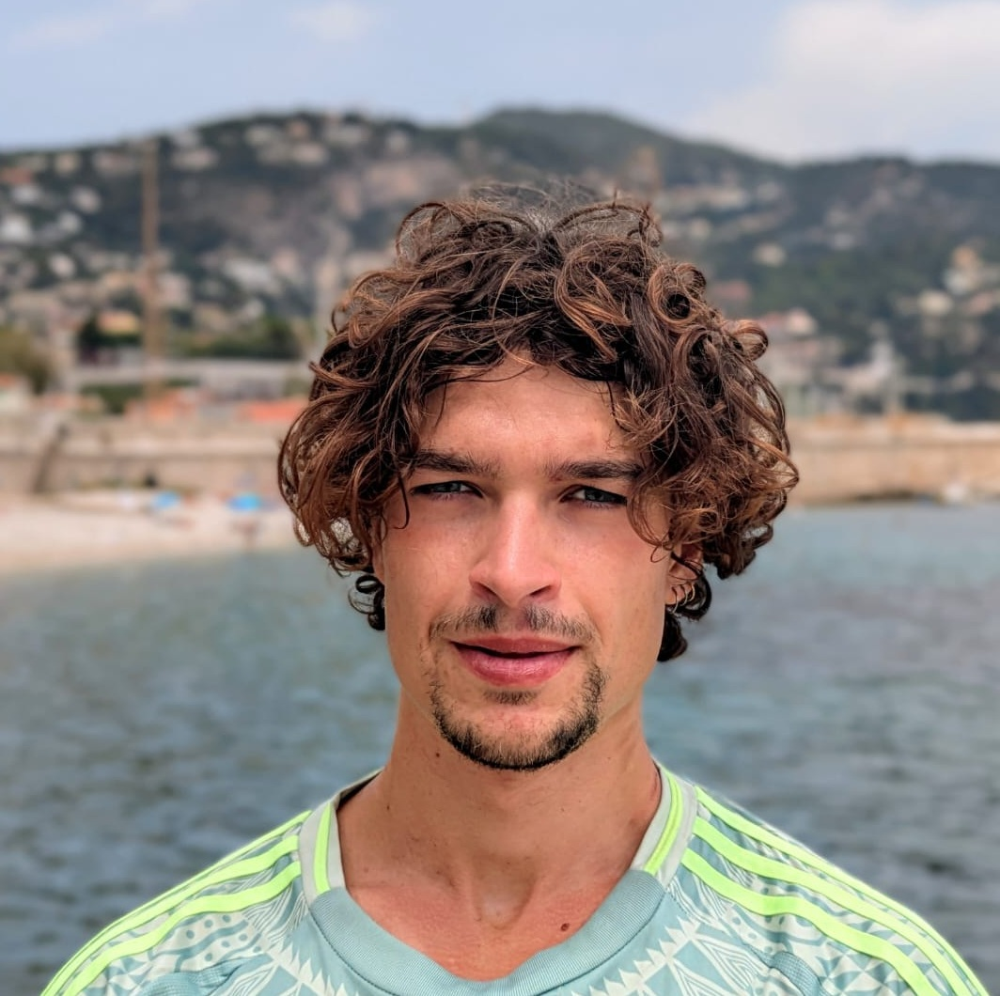

:::: hero-banner
::: hero-overlay
# SOLANE CAÇAO MARTINS FÉVRIER

### Écologie Marine & Projets de Conservation
:::
::::

::: wave-transition
```{=html}
<svg viewBox="0 0 1200 120" preserveAspectRatio="none">

<path d="M0,0 C150,90 350,-40 500,65 C650,170 900,10 1200,40 L1200,120 L0,120 Z" fill="#dbece9"></path>
</svg>
```
:::

:::::::::::::: content-container
:::::: {.grid .profile-section}
:::: {.g-col-12 .g-col-md-4 .profile-sidebar}
{.profile-photo}

### Contact & Réseaux

::: contact-links
[Email](mailto:solane.cacao@gmail.com){.contact-btn} [LinkedIn](https://linkedin.com/in/solane-cacao-martins-fevrier-41659b295/){.contact-btn target="_blank"}
:::
::::

::: {.g-col-12 .g-col-md-8 .profile-bio}
## Bienvenue

Après un parcours pluridisciplinaire liant un master en **Sciences de la Mer** et une licence en **Sciences Humaines et Sociales**, je concentre désormais mes efforts sur des projets où la science se lie à l'humain.

Passionnée par l'océan, je fais partie de ces surfeurs qui ont décidé de rendre à la mer ce qu'elle leur a apporté, en mobilisant mes compétences en **plongée scientifique, travail de terrain, analyses statistiques, outils moléculaires et intégration des contraintes environnementales**.

Intégrant un large panel d'outils, depuis mes travaux sur des campagnes en mer ou encore au Mexique, dans la baie de Californie,je poursuis l'objectif de participer à des projets visant à comprendre les dynamiques marines dans leur ensemble, à contribuer au suivi des populations et à intégrer les savoirs locaux au dialogue en conservation marine.
:::
::::::

::: section-divider
:::

## Domaines d'intérêt

::: interest-tags
[Dynamique & intégrité des zones récifales]{.tag} [Approches spatiales & réseaux écologiques]{.tag} [Enjeux de conservation marine]{.tag} [Compréhension intégrale des écosystèmes]{.tag} [Intégration des savoirs locaux]{.tag} [Médiation scientifique & projets publics]{.tag}
:::

::: section-divider
:::

## Explorer le site

:::::: {.grid .sections-preview}
::: {.g-col-12 .g-col-md-4 .organic-card .organic-card-1}
### Parcours & Projets

Mon profil, mes compétences de terrain (plongée scientifique, campagnes en mer) et le détail des projets auxquels je participe.

[Découvrir mes projets](parcours.qmd){.organic-btn .stretched-link .mt-3}
:::

::: {.g-col-12 .g-col-md-4 .organic-card .organic-card-2}
### Médiation & Société

Vulgarisation scientifique, intégration des savoirs locaux et autres éléments à la croisée de l'art et de l'Océan.

[Explorer](mediation.qmd){.organic-btn .stretched-link .mt-3}
:::

::: {.g-col-12 .g-col-md-4 .organic-card .organic-card-3}
### Recherche & Travaux

Mes synthèses d'études, posters scientifiques, mémoires, ainsi que les démarches méthodologiques et outils (R, Bash, biologie moléculaire) mobilisés.

[Consulter mes travaux](recherche.qmd){.organic-btn .stretched-link .mt-3}
:::
::::::
::::::::::::::
